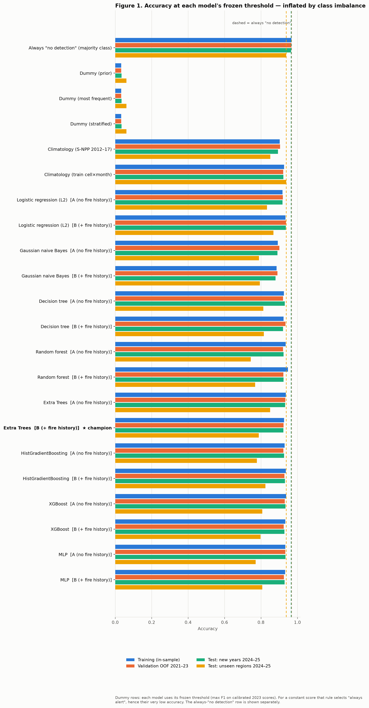
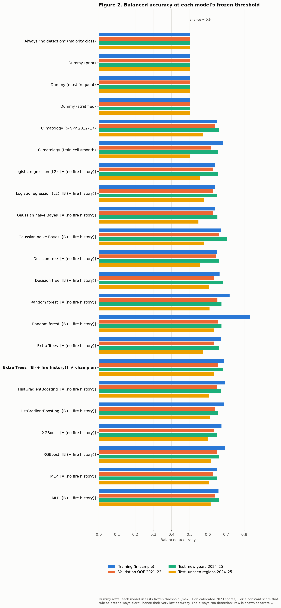
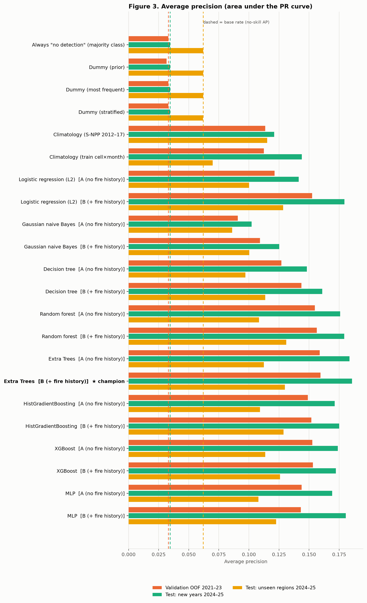
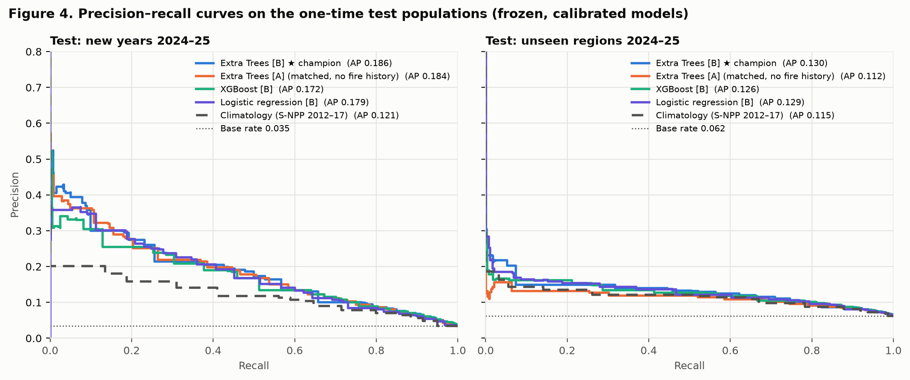
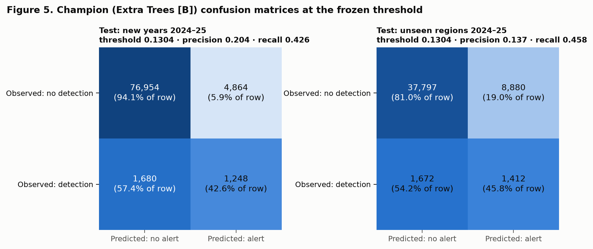

# FireRisk Open v0.3 — model performance audit (reporting only)

Generated by `scripts/model_performance_audit.py` from the frozen v0.3 artefacts. **No model, threshold, calibration or selection was changed; nothing was trained on test data.** Every number is in `MODEL_PERFORMANCE_TABLE.csv` with its `metric_source`.

> Target: a new NOAA-20 VIIRS satellite **detection** in a 0.5° cell on the next UTC day — not ignition or wildfire risk.

## How each column was obtained

* **Train:** the frozen candidate (trained on development targets ≤ 2022) scored on its own training rows. This is in-sample and optimistic.
* **Validation:** rolling-origin out-of-fold predictions for 2021, 2022 and 2023, pooled over 4 development regions with a 32-day embargo.
  * The 2023 fold uses the frozen models.
  * The 2021 and 2022 fold models were not saved in v0.3, so they were **reconstructed** by refitting the frozen configurations.
  * Exactness check: refitting 2023 reproduces the frozen models to max |Δ| = 1.7e-16 on arm64.
  * AP and ROC-AUC use the raw OOF scores and equal the original leaderboard values.
  * The thresholded metrics apply each model's frozen calibrator and threshold. Both were fitted on 2023, so that third of the rows is in-sample for them.
* **Test:** the one-time test populations, kept separate.
  * **T-time:** NRockies, Southwest and Southeast in 2024-02-02…2025-12-31.
  * **T-space:** never-used PNW and Ozarks in 2024–25.
  * Metrics for the 6 models in `test_results_v3.json` are checked to equal the released values.
  * The other candidates are frozen models **re-scored post hoc** for this report. Nothing was selected from them.
* **Thresholds:** each model's frozen threshold (max F1 on calibrated 2023 validation scores).
  * For the constant dummies this rule degenerates to "always alert".
  * The always-"no detection" row is therefore given separately, by definition.
* Consistency checks against released artefacts: **0 discrepancies**.

## Table 1 — accuracy and balanced accuracy (classification)

T-time = new-year test 2024–25; T-space = never-used regions 2024–25. Thresholds are listed in Table 2.

| Model | Feature set | Train acc. | Validation acc. | T-time acc. | T-space acc. | Train bal. acc. | Validation bal. acc. | T-time bal. acc. | T-space bal. acc. |
|---|---|---|---|---|---|---|---|---|---|
| Always "no detection" (majority class) | — | 0.967 | 0.967 | 0.965 | 0.938 | 0.500 | 0.500 | 0.500 | 0.500 |
| Dummy (prior) | — | 0.033 | 0.033 | 0.035 | 0.062 | 0.500 | 0.500 | 0.500 | 0.500 |
| Dummy (most frequent) | — | 0.033 | 0.033 | 0.035 | 0.062 | 0.500 | 0.500 | 0.500 | 0.500 |
| Dummy (stratified) | — | 0.033 | 0.033 | 0.035 | 0.062 | 0.500 | 0.500 | 0.500 | 0.500 |
| Climatology (S-NPP 2012–17) | — | 0.903 | 0.905 | 0.893 | 0.851 | 0.650 | 0.641 | 0.660 | 0.576 |
| Climatology (train cell×month) | — | 0.927 | 0.922 | 0.923 | 0.938 | 0.685 | 0.618 | 0.656 | 0.500 |
| Logistic regression (L2) | A (no fire history) | 0.918 | 0.920 | 0.918 | 0.833 | 0.641 | 0.628 | 0.654 | 0.557 |
| Logistic regression (L2) | B (+ fire history) | 0.934 | 0.938 | 0.936 | 0.869 | 0.641 | 0.627 | 0.652 | 0.579 |
| Gaussian naive Bayes | A (no fire history) | 0.892 | 0.901 | 0.890 | 0.789 | 0.641 | 0.628 | 0.652 | 0.548 |
| Gaussian naive Bayes | B (+ fire history) | 0.886 | 0.891 | 0.880 | 0.794 | 0.671 | 0.662 | 0.704 | 0.578 |
| Decision tree | A (no fire history) | 0.926 | 0.921 | 0.930 | 0.813 | 0.650 | 0.647 | 0.661 | 0.555 |
| Decision tree | B (+ fire history) | 0.924 | 0.934 | 0.921 | 0.816 | 0.664 | 0.634 | 0.682 | 0.608 |
| Random forest | A (no fire history) | 0.936 | 0.921 | 0.924 | 0.744 | 0.719 | 0.652 | 0.675 | 0.609 |
| Random forest | B (+ fire history) | 0.948 | 0.923 | 0.924 | 0.768 | 0.831 | 0.656 | 0.675 | 0.636 |
| Extra Trees | A (no fire history) | 0.936 | 0.933 | 0.933 | 0.850 | 0.670 | 0.635 | 0.661 | 0.572 |
| Extra Trees **★** | B (+ fire history) | 0.927 | 0.924 | 0.923 | 0.788 | 0.689 | 0.656 | 0.683 | 0.634 |
| HistGradientBoosting | A (no fire history) | 0.930 | 0.923 | 0.927 | 0.777 | 0.693 | 0.648 | 0.670 | 0.605 |
| HistGradientBoosting | B (+ fire history) | 0.936 | 0.928 | 0.931 | 0.824 | 0.690 | 0.641 | 0.656 | 0.611 |
| XGBoost | A (no fire history) | 0.938 | 0.930 | 0.934 | 0.807 | 0.675 | 0.635 | 0.651 | 0.598 |
| XGBoost | B (+ fire history) | 0.934 | 0.925 | 0.929 | 0.797 | 0.695 | 0.650 | 0.663 | 0.618 |
| MLP | A (no fire history) | 0.933 | 0.934 | 0.934 | 0.771 | 0.651 | 0.626 | 0.648 | 0.604 |
| MLP | B (+ fire history) | 0.933 | 0.926 | 0.929 | 0.807 | 0.658 | 0.640 | 0.663 | 0.615 |

## Table 2 — ranking and threshold metrics (classification)

| Model | Feature set | Threshold | Validation AP | T-time AP | T-space AP | T-time precision | T-time recall | T-time F1 | T-time ROC-AUC | T-time Brier | T-space precision | T-space recall | T-space F1 | T-space ROC-AUC | T-space Brier |
|---|---|---|---|---|---|---|---|---|---|---|---|---|---|---|---|
| Always "no detection" (majority class) | — | n/a (constant 0) | 0.033 | 0.035 | 0.062 | n/a | 0.000 | 0.000 | 0.500 | 0.0346 | n/a | 0.000 | 0.000 | 0.500 | 0.0620 |
| Dummy (prior) | — | 0.0339 | 0.032 | 0.035 | 0.062 | 0.035 | 1.000 | 0.067 | 0.500 | 0.0334 | 0.062 | 1.000 | 0.117 | 0.500 | 0.0589 |
| Dummy (most frequent) | — | 0.0339 | 0.033 | 0.035 | 0.062 | 0.035 | 1.000 | 0.067 | 0.500 | 0.0334 | 0.062 | 1.000 | 0.117 | 0.500 | 0.0589 |
| Dummy (stratified) | — | 0.0339 | 0.033 | 0.035 | 0.062 | 0.035 | 1.000 | 0.067 | 0.500 | 0.0334 | 0.062 | 1.000 | 0.117 | 0.499 | 0.0589 |
| Climatology (S-NPP 2012–17) | — | 0.1031 | 0.114 | 0.121 | 0.115 | 0.141 | 0.410 | 0.210 | 0.799 | 0.0315 | 0.136 | 0.261 | 0.179 | 0.704 | 0.0568 |
| Climatology (train cell×month) | — | 0.1194 | 0.112 | 0.144 | 0.070 | 0.187 | 0.370 | 0.248 | 0.814 | 0.0311 | n/a | 0.000 | 0.000 | 0.545 | 0.0589 |
| Logistic regression (L2) | A (no fire history) | 0.1185 | 0.121 | 0.141 | 0.100 | 0.176 | 0.370 | 0.239 | 0.789 | 0.0312 | 0.111 | 0.241 | 0.152 | 0.676 | 0.0579 |
| Logistic regression (L2) | B (+ fire history) | 0.1256 | 0.153 | 0.179 | 0.129 | 0.225 | 0.346 | 0.273 | 0.827 | 0.0305 | 0.154 | 0.249 | 0.190 | 0.723 | 0.0564 |
| Gaussian naive Bayes | A (no fire history) | 0.1138 | 0.091 | 0.102 | 0.086 | 0.134 | 0.397 | 0.200 | 0.762 | 0.0317 | 0.093 | 0.273 | 0.138 | 0.630 | 0.0581 |
| Gaussian naive Bayes | B (+ fire history) | 0.1138 | 0.109 | 0.125 | 0.100 | 0.147 | 0.516 | 0.229 | 0.798 | 0.0313 | 0.111 | 0.332 | 0.166 | 0.675 | 0.0573 |
| Decision tree | A (no fire history) | 0.1591 | 0.127 | 0.148 | 0.097 | 0.211 | 0.373 | 0.270 | 0.792 | 0.0307 | 0.103 | 0.260 | 0.147 | 0.673 | 0.0585 |
| Decision tree | B (+ fire history) | 0.1374 | 0.144 | 0.161 | 0.114 | 0.200 | 0.425 | 0.272 | 0.814 | 0.0305 | 0.137 | 0.371 | 0.200 | 0.704 | 0.0569 |
| Random forest | A (no fire history) | 0.1272 | 0.155 | 0.176 | 0.108 | 0.203 | 0.407 | 0.271 | 0.832 | 0.0308 | 0.113 | 0.455 | 0.180 | 0.692 | 0.0575 |
| Random forest | B (+ fire history) | 0.1295 | 0.156 | 0.179 | 0.131 | 0.203 | 0.407 | 0.271 | 0.834 | 0.0306 | 0.130 | 0.485 | 0.206 | 0.723 | 0.0560 |
| Extra Trees | A (no fire history) | 0.1567 | 0.159 | 0.184 | 0.112 | 0.219 | 0.370 | 0.275 | 0.834 | 0.0305 | 0.132 | 0.254 | 0.174 | 0.702 | 0.0568 |
| Extra Trees **★** | B (+ fire history) | 0.1304 | 0.159 | 0.186 | 0.130 | 0.204 | 0.426 | 0.276 | 0.840 | 0.0305 | 0.137 | 0.458 | 0.211 | 0.726 | 0.0559 |
| HistGradientBoosting | A (no fire history) | 0.1342 | 0.149 | 0.171 | 0.109 | 0.206 | 0.395 | 0.271 | 0.831 | 0.0308 | 0.119 | 0.408 | 0.185 | 0.698 | 0.0578 |
| HistGradientBoosting | B (+ fire history) | 0.1282 | 0.152 | 0.175 | 0.129 | 0.211 | 0.361 | 0.267 | 0.837 | 0.0306 | 0.143 | 0.367 | 0.205 | 0.726 | 0.0567 |
| XGBoost | A (no fire history) | 0.1333 | 0.153 | 0.174 | 0.114 | 0.217 | 0.347 | 0.267 | 0.833 | 0.0306 | 0.127 | 0.359 | 0.187 | 0.703 | 0.0584 |
| XGBoost | B (+ fire history) | 0.1299 | 0.153 | 0.172 | 0.126 | 0.209 | 0.378 | 0.269 | 0.837 | 0.0306 | 0.134 | 0.414 | 0.202 | 0.724 | 0.0568 |
| MLP | A (no fire history) | 0.1275 | 0.144 | 0.169 | 0.108 | 0.215 | 0.341 | 0.264 | 0.821 | 0.0306 | 0.117 | 0.413 | 0.183 | 0.689 | 0.0594 |
| MLP | B (+ fire history) | 0.1291 | 0.143 | 0.181 | 0.123 | 0.210 | 0.377 | 0.270 | 0.833 | 0.0305 | 0.136 | 0.396 | 0.203 | 0.717 | 0.0584 |

Base rates (= AP of a no-skill ranking): train 0.0333, validation 0.0330, T-time 0.0346, T-space 0.0620.

## Table 3 — regression: log1p(next-day qualifying detection count), feature set B

All 8 regressors were trained (≤ 2022) and frozen in v0.3. Validation here is the single 2023 hold-out, not rolling-origin CV.

| Model | Train MAE | Train MSE | Train RMSE | Train R² | Val MAE | Val MSE | Val RMSE | Val R² | T-time MAE | T-time RMSE | T-time R² | T-space MAE | T-space RMSE | T-space R² |
|---|---|---|---|---|---|---|---|---|---|---|---|---|---|---|
| mean constant | 0.0780 | 0.0674 | 0.2596 | 0.0000 | 0.0777 | 0.0618 | 0.2487 | -0.0000 | 0.0791 | 0.2564 | -0.0000 | 0.1024 | 0.3117 | -0.0074 |
| median constant | 0.0403 | 0.0690 | 0.2627 | -0.0241 | 0.0401 | 0.0634 | 0.2519 | -0.0260 | 0.0416 | 0.2598 | -0.0263 | 0.0671 | 0.3178 | -0.0467 |
| linear regression | 0.0783 | 0.0647 | 0.2543 | 0.0401 | 0.0767 | 0.0593 | 0.2435 | 0.0412 | 0.0770 | 0.2502 | 0.0474 | 0.1292 | 0.3075 | 0.0198 |
| ridge a10 | 0.0783 | 0.0647 | 0.2543 | 0.0401 | 0.0767 | 0.0593 | 0.2435 | 0.0412 | 0.0770 | 0.2502 | 0.0474 | 0.1292 | 0.3075 | 0.0198 |
| random forest regressor | 0.0648 | 0.0522 | 0.2284 | 0.2260 | 0.0715 | 0.0577 | 0.2401 | 0.0675 | 0.0747 | 0.2489 | 0.0574 | 0.1378 | 0.3101 | 0.0034 |
| hist gradient boosting regressor | 0.0659 | 0.0516 | 0.2271 | 0.2348 | 0.0711 | 0.0584 | 0.2416 | 0.0560 | 0.0734 | 0.2501 | 0.0488 | 0.1295 | 0.3099 | 0.0043 |
| mlp regressor | 0.0695 | 0.0596 | 0.2442 | 0.1149 | 0.0710 | 0.0586 | 0.2421 | 0.0524 | 0.0731 | 0.2508 | 0.0431 | 0.1364 | 0.3203 | -0.0636 |
| xgboost regressor | 0.0634 | 0.0464 | 0.2154 | 0.3113 | 0.0716 | 0.0586 | 0.2421 | 0.0521 | 0.0763 | 0.2524 | 0.0313 | 0.1414 | 0.3162 | -0.0364 |

## Findings (generated from the tables)

* **Validation (selection data):** the highest pooled OOF AP is Extra Trees [B (+ fire history)] (0.159).
  * The champion was chosen by the pre-registered 1-SE + leave-one-region-out rule, which this audit does not revisit.
  * Champion vs Extra Trees without fire history: Δ +0.001 (95% CI -0.003 to +0.008), a tie.
  * Champion vs logistic regression [B]: Δ +0.007 (95% CI -0.000 to +0.020).
* **New-year test:** the highest AP is Extra Trees [B (+ fire history)] (0.186).
  * Δ vs climatology +0.065 (95% CI +0.047 to +0.086): clearly better.
  * Δ vs the other strong learned models is within ±0.015 and mostly not significant; vs XGBoost [B] it is +0.013 (95% CI +0.001 to +0.030).
* **Never-used regions:** the highest AP is Random forest [B (+ fire history)] (0.131).
  * The champion is statistically tied with it: Δ vs random forest [B] -0.001 (95% CI -0.007 to +0.003).
  * It beats its no-fire-history twin by +0.017 (95% CI +0.011 to +0.026) and climatology by +0.015 (95% CI +0.007 to +0.024).
* **Accuracy is not informative here.** The always-"no detection" rule scores the highest accuracy everywhere (0.965 on T-time) with balanced accuracy 0.5 and zero recall.
* **Balanced accuracy** depends on each model's frozen threshold and favours high-recall operating points.
  * Highest validation balanced accuracy: Gaussian naive Bayes [B (+ fire history)] (0.662).
  * Highest T-time balanced accuracy: Gaussian naive Bayes [B (+ fire history)] (0.704).
  * Highest T-space balanced accuracy: Random forest [B (+ fire history)] (0.636).
  * Naive Bayes [B] reaches its high balanced accuracy with low precision and much lower AP.
* **Over-fitting:** the champion's train-minus-validation balanced-accuracy gap is 0.034; random forest [B] shows 0.175 (train balanced accuracy is in-sample).
* **Regression:** all 8 regressors were trained. Mean and median constants are the baselines.
  * The best validation R² is ~0.07 (random forest); test R² is ≤ 0.06 on new years and ≤ 0.02 in unseen regions, where several models are below 0.
  * These are genuinely poor results, not missing ones: next-day counts are mostly zero, and the features explain little of their variance.
* **Bottom line:** the learned models clearly beat climatology. The differences *between* the top tree/boosting/logistic models are within sampling noise. Fire-history features matter for unseen regions, not within known regions.

## Artefact integrity

* `frozen_candidates_v3.joblib` SHA-256 matches the freeze commit (`f23be7e3…`).
* `model_v3.joblib` differs from the freeze-time hash only because `run_final_test_v3` re-saved it with `test_evaluated=True`
  and the test summary after the one-time test. The model, calibrator and threshold were unchanged; a from-scratch rebuild matches its
  predictions to ≤ 1.5e-14.
* `regression_frozen_v3.joblib` had no hash recorded at freeze. Its validation and test RMSE equal the released values exactly.

## Table 4 — is the champion meaningfully better? Paired week-block bootstrap of Δ AP (champion − rival)

Same rows, same 1,000 resampled sets of ISO weeks for both models. Validation uses the raw OOF scores (2021–23).

| Population | Rival | Δ AP | 95% CI | Share of resamples where the champion is better |
|---|---|---|---|---|
| Rolling-origin validation OOF 2021–2023 | Extra Trees [A (no fire history)] | +0.0007 | -0.0034 to +0.0080 | 0.70 |
| Rolling-origin validation OOF 2021–2023 | Random forest [B (+ fire history)] | +0.0030 | -0.0013 to +0.0102 | 0.91 |
| Rolling-origin validation OOF 2021–2023 | XGBoost [B (+ fire history)] | +0.0062 | -0.0037 to +0.0212 | 0.88 |
| Rolling-origin validation OOF 2021–2023 | Logistic regression (L2) [B (+ fire history)] | +0.0069 | -0.0005 to +0.0197 | 0.96 |
| Rolling-origin validation OOF 2021–2023 | HistGradientBoosting [B (+ fire history)] | +0.0076 | -0.0027 to +0.0227 | 0.92 |
| Rolling-origin validation OOF 2021–2023 | MLP [B (+ fire history)] | +0.0163 | +0.0097 to +0.0266 | 1.00 |
| Rolling-origin validation OOF 2021–2023 | Climatology (S-NPP 2012–17) | +0.0460 | +0.0295 to +0.0686 | 1.00 |
| New-year test 2024–25 | Extra Trees [A (no fire history)] | +0.0021 | -0.0027 to +0.0075 | 0.79 |
| New-year test 2024–25 | Random forest [B (+ fire history)] | +0.0064 | -0.0003 to +0.0152 | 0.96 |
| New-year test 2024–25 | XGBoost [B (+ fire history)] | +0.0134 | +0.0010 to +0.0303 | 0.98 |
| New-year test 2024–25 | Logistic regression (L2) [B (+ fire history)] | +0.0063 | -0.0003 to +0.0145 | 0.97 |
| New-year test 2024–25 | HistGradientBoosting [B (+ fire history)] | +0.0106 | -0.0017 to +0.0282 | 0.95 |
| New-year test 2024–25 | MLP [B (+ fire history)] | +0.0051 | -0.0029 to +0.0144 | 0.88 |
| New-year test 2024–25 | Climatology (S-NPP 2012–17) | +0.0647 | +0.0473 to +0.0860 | 1.00 |
| Never-used regions 2024–25 | Extra Trees [A (no fire history)] | +0.0174 | +0.0109 to +0.0256 | 1.00 |
| Never-used regions 2024–25 | Random forest [B (+ fire history)] | -0.0012 | -0.0069 to +0.0034 | 0.35 |
| Never-used regions 2024–25 | XGBoost [B (+ fire history)] | +0.0040 | -0.0031 to +0.0125 | 0.84 |
| Never-used regions 2024–25 | Logistic regression (L2) [B (+ fire history)] | +0.0013 | -0.0035 to +0.0074 | 0.68 |
| Never-used regions 2024–25 | HistGradientBoosting [B (+ fire history)] | +0.0011 | -0.0050 to +0.0079 | 0.59 |
| Never-used regions 2024–25 | MLP [B (+ fire history)] | +0.0072 | -0.0005 to +0.0160 | 0.96 |
| Never-used regions 2024–25 | Climatology (S-NPP 2012–17) | +0.0146 | +0.0074 to +0.0236 | 1.00 |

## Figures

*Accuracy (dashed: always-"no detection" accuracy for each population). PDF: `figures/fig1_accuracy.pdf`.*

*Balanced accuracy (dashed: chance). PDF: `figures/fig2_balanced_accuracy.pdf`.*

*Average precision (dashed: base rates). PDF: `figures/fig3_average_precision.pdf`.*

*Precision–recall curves on both test populations. PDF: `figures/fig4_precision_recall.pdf`.*

*Champion confusion matrices. PDF: `figures/fig5_confusion_matrices.pdf`.*

